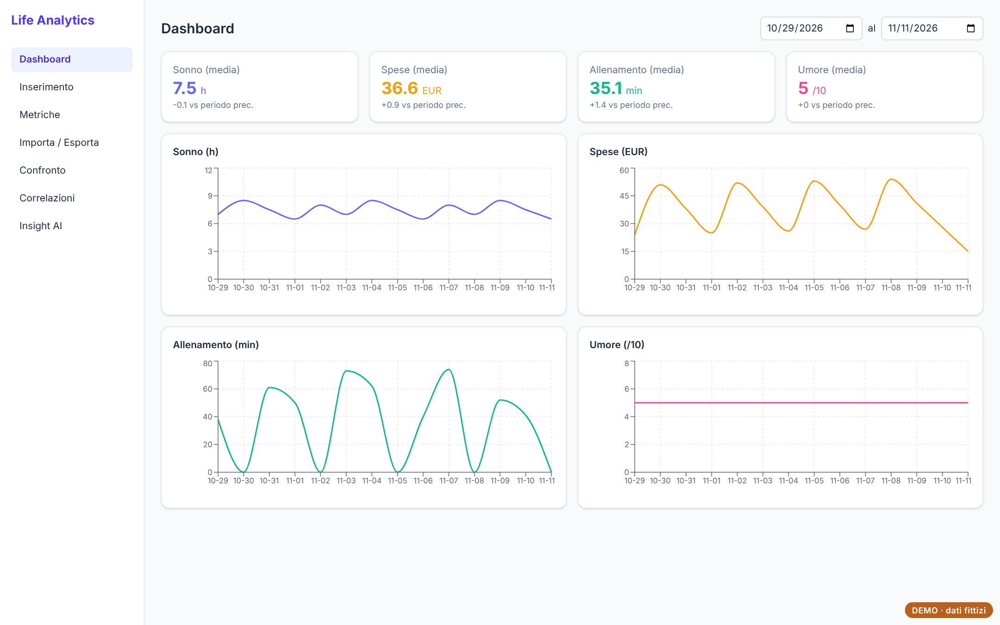
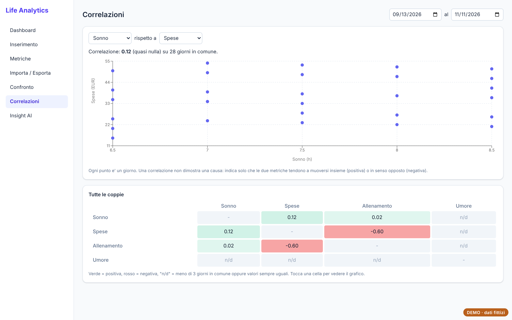
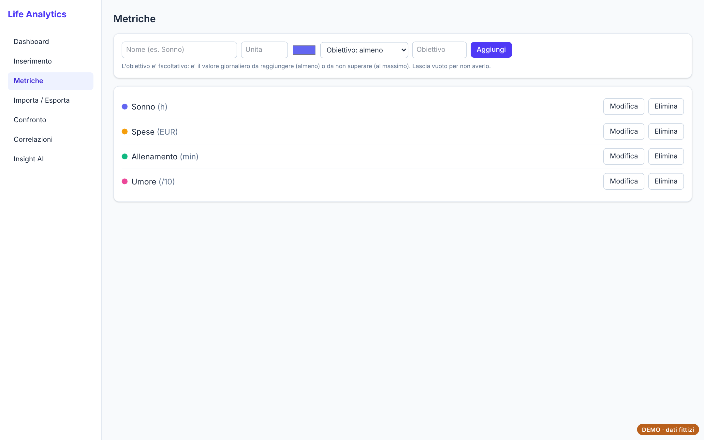
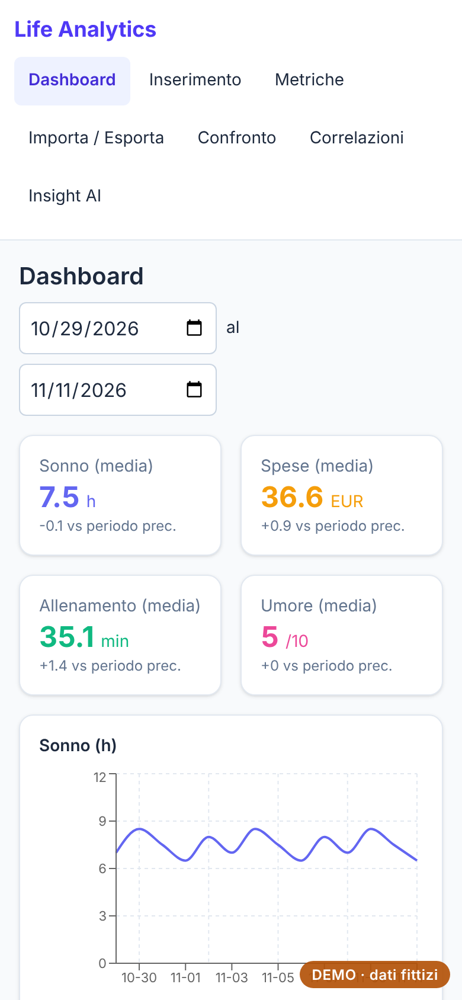

# Life Analytics

Analisi dei dati personali (sonno, spese, allenamento, umore o qualunque metrica): andamento nel tempo, obiettivi, confronti tra periodi e correlazioni.

**[Prova la demo](https://andreapollastrelli95.github.io/life-analytics-demo/)** · dati fittizi, salvati solo nel tuo browser; nella demo l'assistente AI è disattivato.



## Cosa fa

- **Metriche personalizzate** con unità, colore e obiettivo (almeno / al massimo).
- **Dashboard** con media del periodo, variazione rispetto al periodo precedente e grafici con la linea dell'obiettivo.
- **Correlazioni**: grafico a dispersione e tabella di tutte le coppie di metriche.
- **Confronto tra periodi** e **Insight AI** generati su richiesta (Google Gemini).
- **Importa / esporta CSV** con controllo dei dati.

| Correlazioni | Metriche | Telefono |
|---|---|---|
|  |  |  |

## Come è fatto

React, TypeScript, Vite, Tailwind CSS, Recharts, Dexie (IndexedDB), React Router; server Node per la sincronizzazione; Electron per la versione desktop.

I dati vivono nel browser (IndexedDB) e vengono sincronizzati con un archivio centrale tramite `/api/data`, con controllo di versione per non sovrascrivere le modifiche fatte da un altro dispositivo. Nella demo `public/demo-api.js` sostituisce il server con un archivio locale che segue le stesse regole.

## Avviarlo in locale

```bash
npm install
npm run dev      # sviluppo
npm run build    # versione web in dist/
```

---

Progetto di [Andrea Pollastrelli](https://andreapollastrelli95.github.io/).
